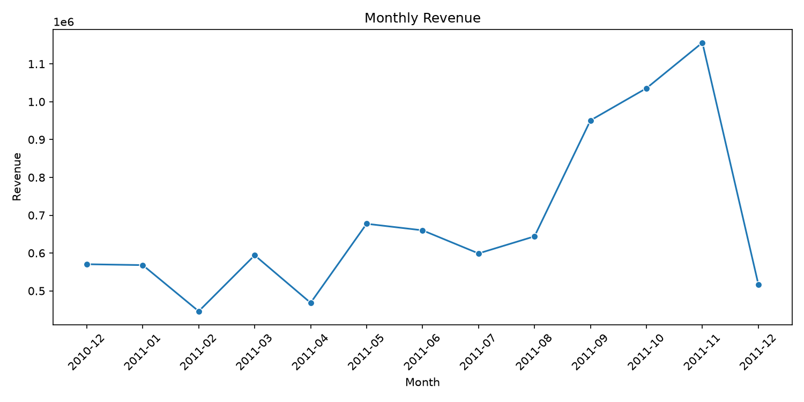
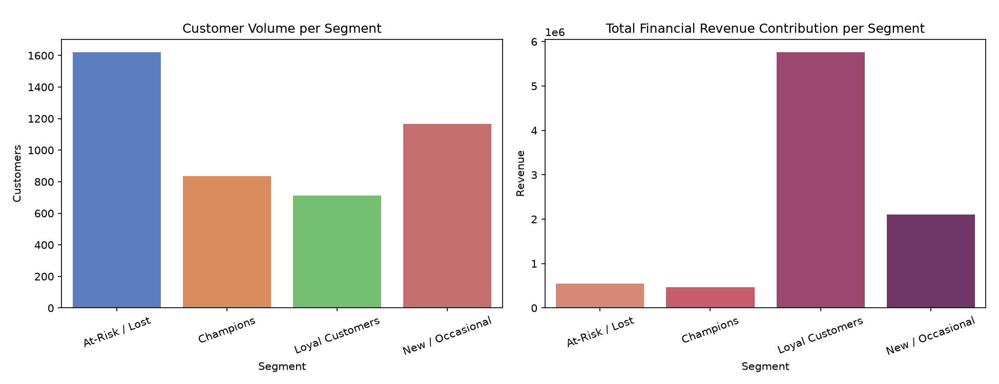
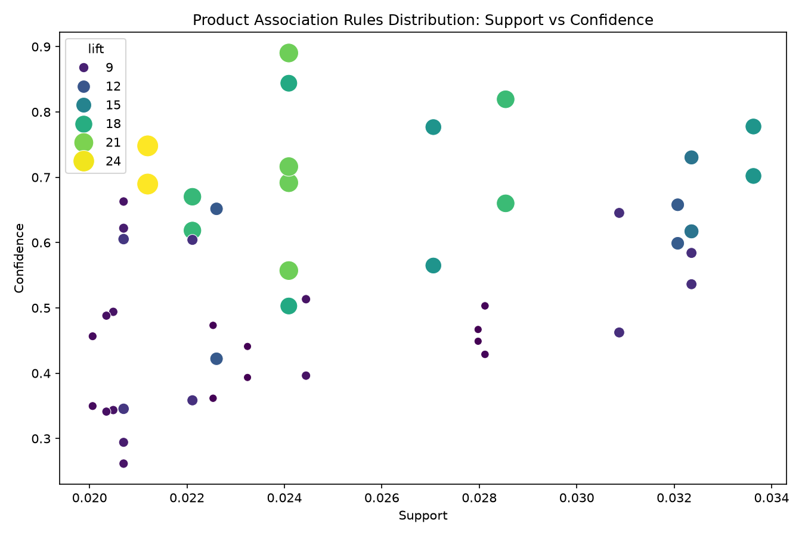

# E-Commerce Customer & Product Analytics

Customer segmentation (RFM K-Means Clustering) and market basket analysis (Apriori Association Rules) on UK online retail transactions, with data-driven business recommendations for marketing and cross-selling.

## Business Problem
An online retailer wants to isolate its highest-value customer brackets, detect at-risk drifting clients, and discover high-affinity product relationships to optimize targeted marketing campaigns and checkout recommendations.

## Dataset
[E-Commerce Data on Kaggle](https://kaggle.com) (UCI Online Retail Archive): Contains 541,909 raw transaction entries from Dec 2010 to Dec 2011. 
*Note: The raw data file is omitted from tracking via `.gitignore`. Download directly from Kaggle and place inside `data/`.*

## Tools
Python, Pandas, NumPy, Matplotlib, Seaborn, Plotly, scikit-learn, mlxtend, Jupyter

## Methodology
1. **Cleaning:** Dropped missing CustomerIDs, duplicates, transactional returns, and zero-value logs ($541,909 \rightarrow 392,692$ verified rows).
2. **EDA:** Plotted continuous monthly revenue streams, isolated high-volume country distributions, and mapped hourly demand density.
3. **RFM Features:** Engineered Recency, Frequency, and Monetary scores mapped to individual Customer IDs.
4. **K-Means Clustering:** Handled outlier skewness via Log-Transform and StandardScaler, setting an optimal hyperparameter baseline of $k=4$ using Elbow and Silhouette co-efficiency visuals.
5. **Association Rules:** Ran the Apriori pattern engine on UK orders across the top 150 products with a minimum support baseline of 0.02.

## Key Findings
- Total Cleaned Revenue: £[Insert total revenue from Cell 4] across [Insert unique customers count from Cell 4] buyers.
- Revenue trends peak significantly in November, with the United Kingdom generating [Insert UK share % from Cell 7] of total income.
- **Champions & Loyal Segments** make up the minority of customer volume but generate over [Insert combined revenue % from Cell 15] of total corporate income.
- Top Product Pair: [Insert Antecedent] + [Insert Consequent] (Confidence: [X]%, Lift: [X]).





## Business Recommendations
1. Reward Champions with tier-based loyalty access models.
2. Deploy time-sensitive coupon win-back cadences for At-Risk users.
3. Establish introductory automated welcome mail sets for New buyers.
4. Bundle high-lift product configurations inside cart interfaces.
5. Scale inventory capacity planning ahead of peak seasonal months.

## How to Run
```bash
git clone https://github.com
cd ecommerce-customer-product-analytics
pip install -r requirements.txt
# Place downloaded data.csv from Kaggle into the data/ folder
jupyter notebook notebooks/analysis.ipynb
```

## Author
Dasari Pallavi | https://www.linkedin.com/in/dasari-pallavi/
